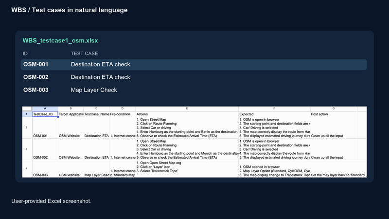

# WBS Test Agent

Turn test cases written in Excel into browser tests, save the evidence, and review the results in Jenkins.
The sample suite tests routes and map layers on [OpenStreetMap](https://www.openstreetmap.org/).



## How it works

1. **Check the input.** Python guardrail rules scan the whole workbook. A violation stops the run before any AI or browser calls.
2. **Translate the case.** GLM turns the Excel steps into a structured test plan.
3. **Validate the plan.** Python checks its structure, original requirements, allowed actions and case constraints.
4. **Run the test.** Playwright performs browser actions and checks. Declared map checks also use image analysis.
5. **Save the evidence.** Each run produces reports, results, screenshots and browser traces.
6. **Review and report.** Claude Haiku analyses the saved evidence. Python selects eligible ticket suggestions; you approve which ones are sent to Jira.

Python controls execution and validation. AI provides translation, limited locator repair, image observations and suggested explanations.
AI analysis never changes the original test verdict or relaxes an expected result.

## Quick start

Run these commands from the project root. You need Python 3.11 or later and `uv` installed.

### 1. Install dependencies and Chromium

```sh
uv sync --locked
PLAYWRIGHT_BROWSERS_PATH="$PWD/.browsers" uv run playwright install chromium
```

### 2. Configure your local credentials

If you do not already have `.env`, create one using [.env.example](.env.example) as a template.
Fill in the values needed for your run:

| Setting | Purpose |
| --- | --- |
| `OPENAI_API_KEY`, `OPENAI_BASE_URL` | GLM credentials and compatible API address for translation and locator repair |
| `OPENAI_DEFAULT_MODEL` | Your GLM model name; `OPENAI_MODEL` can override it |
| `OPENROUTER_API_KEY` | Clef route-image checks |
| `ANTHROPIC_API_KEY` | Claude audit analysis and optional vision clicks |

The template selects `VISION_PROVIDER=clef` and `VISION_MODEL=cloudflare/clef` for route checks.
Audit uses Claude Haiku through `AUDIT_MODEL`; vision clicks use `VISION_CLICK_MODEL`.
Jira credentials are only needed when using Jira commands.

Keep real credentials in your local `.env` or Jenkins Credentials. Never put them in Excel or commit them to Git.

### 3. Check the workbook without calling AI

```sh
uv run python -m test_agent guardrail cases/osm/WBS_testcase1_osm.xlsx
```

Expected: `Guardrail PASSED — 3 cases checked`.

### 4. Run all sample cases

```sh
uv run python -m test_agent suite cases/osm/WBS_testcase1_osm.xlsx \
  --locators cases/osm/locators.json --headed
```

Omit `--headed` to run without a visible browser window. This command visits the live website and makes model API calls, which may incur charges.
The final output shows the saved run directory. Open its `report.html` to inspect the results.

**OSM-002 is intentionally designed to fail.** A correct demonstration can therefore return exit code 1 and appear as UNSTABLE in Jenkins.

## Read the results

| Status | Meaning |
| --- | --- |
| `VALIDATED` | The plan passed the implemented validation rules; the test has not passed yet |
| `REJECTED` | The proposed plan did not pass validation |
| `PASSED` | The executed checks passed |
| `FAILED` | An observed result did not meet the expected result |
| `BLOCKED` | The test could not complete or a check was inconclusive |
| `NOT_RUN` | A step or check was not executed |
| `BLOCKED_BY_GUARDRAIL` | Input was rejected before test execution |

For `suite`, exit **0** means all cases passed, **1** means a case failed or was blocked, **2** indicates an input error reported by the command, and **3** means the guardrail blocked the run.
An outcome being “as designed” does not turn a FAILED case into PASSED.

A completed suite is saved under `artifacts/suite-<id>/`:

| File or folder | What to look for |
| --- | --- |
| `report.html` | Readable case and step results, expected versus actual values, and screenshots |
| `summary.json` | Case totals and final statuses |
| `audit.csv` | Rows for cases, actions, checks and cleanup; suitable for Excel |
| `junit.xml` | Step-level results for Jenkins |
| `guardrail.json` | Input-check results, with masked violations when blocked |
| `cases/<case-id>/translation/` | Source snapshot, validation and generated plan |
| `cases/<case-id>/run/` | Detailed results, screenshots and `trace.zip` |

Blocked runs save the guardrail result and a summary, without creating execution evidence.
Standalone translations and executions use `translation-<id>/` and `run-<id>/` directories.

To share a completed suite:

```sh
uv run python -m test_agent package artifacts/suite-<id> --output-dir reports
```

Replace `<id>` with a real run ID. The package includes HTML, CSV, JUnit, a summary and `evidence.zip`, plus available guardrail/audit/Jira files.
Extract `evidence.zip` beside the downloaded `report.html` to make its full evidence links work.

## Edit or add test cases

Each Excel row is one case. Use these columns:

`TestCase_ID`, `Target Application`, `TestCase_Name`, `Pre-condition`, `Actions`, `Expected`, `Post action`.

Actions and Expected must use consecutive numbered entries starting at 1, with one Expected entry for each Action step.
Use the files beside the workbook to configure the suite:

| File | Purpose |
| --- | --- |
| `guardrail.json` | Required: allowed applications/URLs, step verbs and blocked phrases |
| `contracts.json` | Explicit case constraints, such as cities, duration limits and declared vision checks |
| `vocabulary.json` | Standard names for targets used in translated plans |
| `locators.json` | Rules for finding those targets in the browser |

Contracts and vocabulary are optional for generic translation. Without them, validation has fewer case-specific checks.
Changing the workbook makes saved plans stale. Translate again; for contract-only changes, use `revalidate` on an unchanged saved plan.

### Guardrail rules

The guardrail checks every case and text column, including cases you did not select for translation.
It blocks unknown apps, foreign URL hosts, unsupported step verbs, blocked words/phrases, email addresses and known secret formats.
Missing or invalid configuration also blocks the run.

Blocked phrases include `s` / `es` endings on their final word: for example, `password` also matches `passwords`.
Word boundaries remain: `tokenizer` does not match `token`. Console warnings group by case and step; JSON keeps every violation.

Application URLs come from `allowed_apps` in `guardrail.json`. A `--url` override must match the case's configured URL.
A new website also needs suitable browser locators and any relevant vocabulary/contracts.
The input rules and saved check results share the filename `guardrail.json`; keep report output separate from the workbook directory.

Try the deliberately blocked demo:

```sh
uv run python -m test_agent guardrail cases/guardrail-demo/guardrail-demo.xlsx
```

Expected: masked warnings for OSM-004 and exit code **3**. Regenerate the demo with `uv run python scripts/make_guardrail_demo.py`.
For future login tests, deliberately review the blocked-word rules and obtain test credentials from Jenkins Credentials, never Excel.

## Audit analysis and Jira

Audit is a separate review of saved evidence, including PASSED cases. It does not rerun the browser tests.
Claude Haiku suggests likely causes and next steps. When it asks about a screenshot, a separate Haiku request receives a neutral question and image without the expected answer.
Python validates the response and evidence references.

```sh
uv run python -m test_agent audit-agent artifacts/suite-<id>
```

This calls Anthropic and saves `audit_analysis.md`, `audit_analysis.json` and approval metadata in `audit_review.json`.
Read the analysis alongside the original results. Missing or invalid model analysis is reported as unavailable or partial; it does not invent a finding or change a test status.

Python creates ticket candidates from validated findings with cited FAILED checks:

- `software_bug` → bug candidate.
- `test_case_problem` → test-case-fix candidate.

The model's `recommend_ticket` is advisory. Other categories and BLOCKED-only evidence do not produce candidates.
Jira uses a fingerprint derived from the case, cited failing steps and Excel expectations to find existing open issues.
It comments on an existing match instead of creating another issue; legacy matches receive the new fingerprint label.

For an offline preview, package the audited suite and use an actual finding ID from its analysis:

```sh
uv run python -m test_agent package artifacts/suite-<id> --output-dir reports
uv run python -m test_agent jira create reports --approved F-OSM-002-1 --dry-run
```

Dry-run sends no HTTP requests. Live writes require explicit approved IDs and `--send`.
For authentication or project-access problems, run `uv run python -m test_agent jira check`; it performs read-only checks.

## Run in Jenkins

Follow the [Jenkins setup and troubleshooting guide](docs/ci/jenkins-guide.md) ([中文](docs/ci/jenkins-guide.zh-CN.md)) for Docker, plugins, credentials and job configuration.

The main stages are **Setup → Guardrail → Unit tests → Test suite → Audit analysis → Review tickets → Record decision and Jira**.
An optional Jira connection check runs after Guardrail when `CHECK_JIRA_CONNECTION` is selected; use it for troubleshooting.

- **Test Result:** step-level JUnit results.
- **Test Report:** the readable HTML report and audit analysis.
- **Artifacts:** downloadable reports and evidence.

With ticket candidates, Review tickets pauses for up to 30 minutes. All choices start unticked.
Select the findings you want and click **Create Jira ticket**. No approval means no Jira writes; no candidates means the review/Jira stages are skipped.

Use **Build with Parameters → WORKBOOK=cases/guardrail-demo/guardrail-demo.xlsx** to demonstrate a red Guardrail stage with later stages skipped.
Return to the default OSM workbook for a normal run.

## Other useful commands

Replace placeholder paths with the directories printed by your own runs.

```sh
# Translate one case without running the browser
uv run python -m test_agent translate cases/osm/WBS_testcase1_osm.xlsx --case OSM-001

# Run a validated plan
uv run python -m test_agent run artifacts/translation-<id>/cases/OSM-001 --locators cases/osm/locators.json

# Reuse current valid plans where available; translate missing or stale ones
uv run python -m test_agent suite cases/osm/WBS_testcase1_osm.xlsx --locators cases/osm/locators.json --reuse

# Rebuild HTML from saved results without model calls
uv run python -m test_agent report artifacts/suite-<id>

# Repeat execution three times; all cases must already have current valid plans
uv run python -m test_agent repeat cases/osm/WBS_testcase1_osm.xlsx --locators cases/osm/locators.json --times 3 --reuse

# Preview deletion of older runs; add --yes only after checking the list
uv run python -m test_agent prune --keep 10

# Run the project's regression tests with fake providers and local browser fixtures
uv run python -m unittest discover -s tests -v
```

Live execution and repeat runs can make model API calls. The regression tests do not need live model credentials; browser tests need the installed Chromium.

## Limits and further reading

This is an OSM testing prototype. Locator repair and vision clicks are limited fallbacks, not unrestricted browser control.
Image-model judgments can be wrong or uncertain. Clef's 0.85 threshold was selected after examining calibration results and has not been confirmed on a new independent dataset.
General preconditions are retained as text rather than automatically executed.

- [Source code](src/test_agent/): start with `guardrail.py`, `cli.py`, `suite.py` and `runner.py`.
- [Early learning examples](examples/): the original Playwright and agent exercises.
